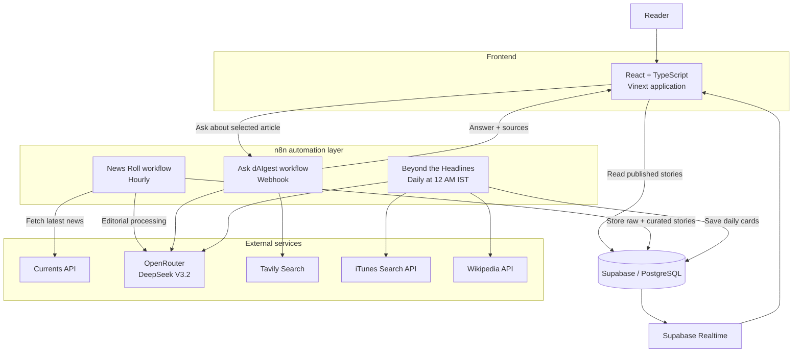

# dAIgest — System Architecture

> **Status:** Architecture documented from the frontend repository and three supplied n8n workflow exports  
> **Repository:** [gairikzzz/dAIgest](https://github.com/gairikzzz/dAIgest)  
> **Last reviewed:** 20 November 2026

## 1. Product overview

dAIgest is an India-first news experience that turns current reporting into concise, multi-source story briefs and lets readers ask contextual follow-up questions. It also includes a daily discovery section, **Beyond the Headlines**, with a word, quotation, podcast recommendation and concept explainer.

The system combines:
- A React + TypeScript web application.
- Supabase for story data, persistence and realtime feed updates.
- n8n for scheduled automation and backend orchestration.
- Currents API for news acquisition.
- DeepSeek V3.2 through OpenRouter for editorial generation and Q&A.
- Tavily for contextual web search in Ask dAIgest.
- iTunes Search and Wikipedia APIs for Beyond the Headlines content.

## 2. High-level architecture

The diagram shows the responsibilities and integrations represented in the supplied workflow exports and frontend code. It does not imply that n8n is the database or that the frontend directly calls Currents, OpenRouter or Tavily.

## 3. Frontend application

**Repository evidence:** `app/page.tsx`, `app/layout.tsx`, `lib/supabase.ts`, `package.json`, `vite.config.ts`

The frontend is a React and TypeScript application running with Vinext/Vite. Its main page handles:
- Category navigation and search across loaded stories.
- Rendering story headlines, summaries, sources, images and suggested questions.
- Loading published stories from Supabase.
- Listening for Supabase Realtime changes to the live story table.
- Sending article questions to the Ask dAIgest endpoint.

### Live feed behaviour

1. The browser initializes the Supabase client when the public URL and publishable key are configured.
2. It queries `stories_live` for records with `status = 'published'`.
3. It requests up to 60 stories, ordered by rank score and update time, with a fallback ordering by publication time if the rank/update columns are unavailable.
4. It normalizes and sorts the returned records for display.
5. It subscribes to Postgres changes on `public.stories_live` and updates the feed when records change.
6. If the live data path fails, bundled sample stories can be displayed as fallback content.

## 4. Backend orchestration — n8n

The backend automation is implemented as three supplied n8n workflows. n8n coordinates API calls, AI model execution, data processing and database writes. Supabase/PostgreSQL remains the persistent data layer.

### 4.1 dAIgest News Roll — hourly news pipeline

**Workflow:** `dAIgest News Roll (Deepseek v3.2)`  
**Trigger:** Every hour.

The workflow performs the following stages:

1. **Quota guard:** PostgreSQL increments the daily Currents API usage counter, with a configured ceiling of 220 calls for the day.
2. **News acquisition:** HTTP Request calls Currents API's `/v2/latest-news` endpoint for English-language, India-focused news, requesting 20 articles.
3. **Normalization and filtering:** A Code node parses publication timestamps, keeps a rolling 24-hour freshness window (with a future-time tolerance), validates and canonicalizes URLs, strips tracking parameters, fingerprints articles and removes duplicates within the fetched batch. It also normalizes publisher names/domains and maps upstream categories to category hints.
4. **Raw article persistence:** PostgreSQL upserts normalized records into `raw_articles`, keyed by article fingerprint.
5. **Unprocessed article selection:** PostgreSQL selects recent articles that still need editorial processing.
6. **Rate-limited editorial loop:** A Split in Batches loop processes articles individually, with a 30-second wait between items.
7. **AI editorial processing:** An n8n AI Agent uses DeepSeek V3.2 through OpenRouter. A structured output parser and validation Code node check the generated result.
8. **Image enrichment:** The Image Lite branch checks whether an image is needed and, when required, uses Tavily search before finishing the image selection step.
9. **Story persistence:** The workflow upserts the curated story and its version into PostgreSQL/Supabase.
10. **Top-story refresh:** SQL refreshes the ranked top-story selection after processing.
11. **Rolling expiry:** The hourly maintenance path removes stories and versions older than the rolling 24-hour window, then refreshes the top-story selection.

The curated story record includes fields such as primary and secondary categories, headline, body, card summary, why-it-matters text, starter questions, entities, image, sources, rank score and importance. The exact full database schema should be taken from the database migrations/schema, not inferred solely from the workflow query.

### 4.2 Ask dAIgest — article Q&A workflow

**Workflow:** `Ask dAIgest (Deepseek v3.2)`  
**Trigger:** HTTP POST webhook at the n8n path `ask-daigest`.

The workflow is a request/response backend for questions about a news card.

1. **Webhook receives request:** The POST webhook accepts the incoming question and article/news-card context.
2. **Validate and normalize:** A Code node accepts question aliases (`question`, `query` or `userQuery`), extracts title, summary, URL, source and publication date from supported card/body fields, validates the question length (1–1,000 characters), and requires article title or summary.
3. **Relevance routing:** Greeting-like messages are handled without invoking the AI agent. Other questions proceed to the agent.
4. **AI relevance and answer:** The Ask dAIgest AI Agent uses DeepSeek V3.2 via OpenRouter. Its instructions require it to decide whether the question relates to the selected story.
5. **Conditional web research:** For relevant questions, the agent is instructed to call Tavily exactly once with a focused query combining the article subject and question. Unrelated questions should not trigger Tavily.
6. **Output validation:** A Code node parses and validates the agent's JSON, normalizes the response and source list, and handles invalid or failed model output.
7. **Webhook response:** Separate response nodes return invalid-input errors, greeting responses or the validated answer.

The agent's answer contract distinguishes related, unrelated and unavailable questions. The workflow returns an answer, source information and relevance/verification metadata. It is designed to keep answers concise and avoid claiming independent verification when web search did not provide evidence.

#### Ask API integration contract — important implementation check

The inspected frontend currently sends a request to `{NEXT_PUBLIC_ASK_API_BASE}/api/ask` with `storyId`, `question` and `sessionId`. The supplied n8n workflow exposes the webhook path `/ask-daigest` and its validation node expects the question plus news-card content (title/summary and optional URL/source/date).

These are **not the same request contract**. A proxy/adapter layer must therefore:
- Resolve `storyId` to the selected story record in Supabase.
- Map the story's title, summary, URL, source and publication time into the payload shape expected by the n8n webhook.
- Forward the question.
- Map the n8n response fields (including answer and sources) into the frontend's expected `answer` and `citations` response shape.

The provided workflow export does not establish that this adapter is already deployed. Confirm this mapping in the deployed API/proxy before describing the frontend-to-n8n Q&A connection as a direct integration.

### 4.3 Beyond the Headlines — daily discovery content

**Workflow:** `dAIgest_Beyond_the_Headlines (Deepseek v3.2)`  
**Trigger:** Daily at 12:00 AM IST.

This workflow creates four daily discovery items:

- Word of the day.
- A quotation and author.
- A podcast episode recommendation.
- A concept explainer linked to a Wikipedia article.

Workflow stages:

1. **Daily context:** PostgreSQL reads recently used words, quote authors, podcast topics/URLs and explainer topics/URLs to reduce repetition.
2. **Theme selection:** A Code node selects daily themes to encourage variety.
3. **Curator Agent:** DeepSeek V3.2 via OpenRouter proposes the word, quote, podcast search term and explainer topic/search term in a constrained JSON format.
4. **External content lookup:** HTTP Request nodes query the iTunes Search API for podcast episodes and Wikipedia's API for explainer source material.
5. **Candidate selection:** A Code node filters out previously used podcast/explainer URLs and assembles source material for the writer.
6. **Writer Agent:** A second DeepSeek V3.2 agent writes compact podcast and explainer cards from the retrieved source text, following strict length constraints.
7. **Assembly and persistence:** Code nodes parse and assemble the content; PostgreSQL saves the daily record in `daily_content`, retaining prior values when an individual generated field is unavailable.

## 5. Data and persistence layer — Supabase / PostgreSQL

**Frontend evidence:** `lib/supabase.ts`, `app/page.tsx`, `.env.example`  
**Workflow evidence:** PostgreSQL nodes and SQL in the three supplied n8n exports.

Supabase/PostgreSQL serves as the shared persistence layer between the frontend and n8n workflows.

Tables explicitly referenced in the supplied workflows or frontend include:

| Table | Role evidenced in workflows/code |
|---|---|
| `stories_live` | Published, curated news stories consumed by the frontend |
| `story_versions` | Version/history records associated with curated stories |
| `raw_articles` | Normalized source articles waiting for editorial processing |
| `api_usage` | Daily provider usage counter used by the Currents quota guard |
| `daily_content` | Daily Beyond the Headlines content and recent-item context |

The frontend reads `stories_live` using the Supabase JavaScript client and subscribes to Postgres changes. n8n uses PostgreSQL nodes and SQL to persist and maintain the news pipeline and daily content. The workflow exports reference PostgreSQL credentials by configured credential name; credentials and secrets are not included in this document.

The frontend uses:
- `NEXT_PUBLIC_SUPABASE_URL`
- `NEXT_PUBLIC_SUPABASE_PUBLISHABLE_KEY`

The repository README states that browser access is protected through Row Level Security (RLS). The publishable key is browser-visible; it must be paired with appropriate RLS policies.

## 6. End-to-end data flows

### A. News-to-feed flow

1. The hourly n8n News Roll workflow checks the Currents usage quota.
2. It fetches India-focused English news from Currents API.
3. It normalizes, filters and deduplicates articles.
4. It stores raw article records in PostgreSQL.
5. The editorial agent processes eligible articles using DeepSeek V3.2 through OpenRouter.
6. The workflow validates the generated structured content, enriches images where needed and upserts curated stories and versions.
7. SQL refreshes the ranked top stories and removes expired stories outside the rolling 24-hour window.
8. The frontend queries published rows from `stories_live` and receives subsequent database changes through Supabase Realtime.

### B. Article question-to-answer flow

1. A reader asks a question on a story in the frontend.
2. The frontend sends the story ID, question and browser session ID to its configured Ask API endpoint.
3. An adapter/proxy (if configured) must resolve the story ID and transform the request into the n8n webhook's news-card context contract.
4. n8n validates the question and article context.
5. The workflow handles greetings directly or routes other questions to the DeepSeek-powered agent.
6. For relevant questions, the agent can perform one Tavily search.
7. n8n validates the structured answer and sources, then responds to the webhook.
8. The adapter maps the webhook response to the frontend response contract and the UI renders the answer and citations.

Step 3 and the response mapping in step 8 are required integration points inferred from the two observed contracts; their deployed implementation is not confirmed by the supplied files.

### C. Beyond the Headlines flow

1. The daily schedule triggers the workflow at midnight IST.
2. PostgreSQL supplies recent content history to prevent repetition.
3. The curator agent selects varied daily content themes.
4. iTunes and Wikipedia provide podcast/explainer candidates.
5. The writer agent creates compact cards from the candidate source material.
6. The workflow assembles and saves the daily content record.

## 7. Technology inventory

**Application**
- React, React DOM, TypeScript.
- Vinext and Vite.
- Cloudflare Vite plugin / Wrangler configuration in the repository.

**Backend orchestration and AI**
- n8n workflows.
- DeepSeek V3.2 through OpenRouter.
- Tavily Search for contextual web research in Ask dAIgest.

**Data**
- Supabase.
- PostgreSQL.
- Supabase Realtime.

**Content sources**
- Currents API — news acquisition.
- iTunes Search API — podcast episode discovery.
- Wikipedia API — explainer research.

## 8. Configuration and security boundaries

- Keep Currents, OpenRouter and Tavily credentials in protected n8n credentials/server-side configuration.
- Do not expose provider API keys in browser code or public environment variables.
- Restrict browser access to Supabase through RLS policies; a publishable key is not an authorization policy.
- Validate and constrain webhook inputs, including question length, article URL and article text.
- Treat article content and retrieved web pages as untrusted data, not as model instructions. The Ask workflow explicitly includes this guardrail in its prompt construction and agent instructions.
- The supplied Ask webhook sets allowed origins to `*`. For production, consider restricting CORS to the deployed frontend origin and add appropriate request-abuse controls.
- Avoid exposing n8n production webhook URLs or internal workflow details unnecessarily.

## 9. Reliability and operational considerations

The following are recommendations, not claims that every control is currently deployed:

- Monitor Currents quota usage and workflow failures; the workflow already includes a daily usage counter and retry settings on selected external calls.
- Track ingestion freshness, number of accepted/rejected articles and deduplication outcomes.
- Monitor editorial-agent failures, structured-output validation failures and image-enrichment failures.
- Handle n8n webhook timeouts and provide a clear temporary-unavailability response in the UI.
- Verify that the Ask adapter maps both request and response schemas correctly.
- Validate source URLs and ensure citations returned to readers correspond to the actual research results.
- Handle Supabase Realtime reconnects and refresh the feed periodically in case events are missed.
- Clearly distinguish sample fallback stories from live stories.

## 10. Open implementation checks

1. Confirm the deployed proxy/adapter between frontend `/api/ask` and the n8n `/ask-daigest` webhook, including request and response mapping.
2. Confirm the exact Supabase schema, indexes, constraints and RLS policies for all referenced tables.
3. Confirm the production n8n deployment, webhook authentication and allowed-origin policy.
4. Confirm whether the Beyond the Headlines workflow's `daily_content` records are consumed by the current frontend and through which endpoint/query.
5. Confirm operational monitoring, workflow error notifications, backups and recovery procedures.

## 11. Source artifacts reviewed

**GitHub repository**
- [README.md](https://github.com/gairikzzz/dAIgest/blob/main/README.md)
- [app/page.tsx](https://github.com/gairikzzz/dAIgest/blob/main/app/page.tsx)
- [app/layout.tsx](https://github.com/gairikzzz/dAIgest/blob/main/app/layout.tsx)
- [lib/supabase.ts](https://github.com/gairikzzz/dAIgest/blob/main/lib/supabase.ts)
- [.env.example](https://github.com/gairikzzz/dAIgest/blob/main/.env.example)
- [package.json](https://github.com/gairikzzz/dAIgest/blob/main/package.json)
- [vite.config.ts](https://github.com/gairikzzz/dAIgest/blob/main/vite.config.ts)

**n8n workflow exports supplied for this document**
- `dAIgest News Roll (Deepseek v3.2)`
- `Ask dAIgest (Deepseek v3.2)`
- `dAIgest_Beyond_the_Headlines (Deepseek v3.2)`

---

*This document distinguishes directly observed frontend/workflow behaviour from inferred integration requirements. The n8n exports describe workflow configuration; they do not by themselves prove that credentials, production endpoints or deployments are currently active.*
