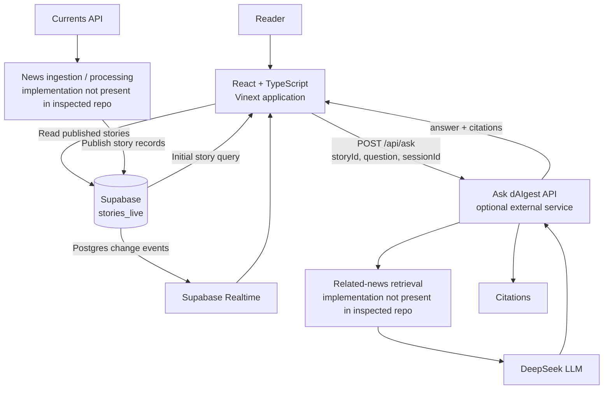

# dAIgest — Architecture Document

> **Status:** Repository-derived architecture overview  
> **Repository:** [gairikzzz/dAIgest](https://github.com/gairikzzz/dAIgest)  
> **Primary application:** [daigest.xyz](https://daigest.xyz)  
> **Last reviewed:** 20 November 2026

## 1. Product overview

dAIgest is an India-first news experience that presents current headlines as concise story briefs and lets readers ask follow-up questions grounded in a selected article. When the selected story does not provide enough context, the product is designed to retrieve related reporting and return citations.

The application has three visible capabilities:

- A category-based news feed with search.
- Short, story-specific briefs and suggested questions.
- Conversational Q&A associated with an individual story.

## 2. Architecture at a glance

The repository shows a browser-facing React application, Supabase as the live story data layer, Currents API as the named news provider, and an optional separately hosted Ask API for conversational answers.



**Diagram interpretation:** Solid connections represent integration points documented in the repository or README. The internal ingestion, retrieval and Ask API implementation details are not present in the inspected application files; those boxes show the product-level flow described by the README, not verified service internals.

## 3. Frontend application

**Evidence:** `app/page.tsx`, `app/layout.tsx`, `package.json`, `vite.config.ts`

The main experience is implemented in the client-side page at `app/page.tsx`. It manages category selection, search, story loading, story presentation, briefing interactions and the article Q&A interface.

The repository's package configuration includes React, React DOM, TypeScript, Vinext and Vite. The Vite configuration installs the Vinext and Cloudflare plugins. The app metadata identifies the product as “dAIgest — News you can question”.

### Story feed behaviour

1. The page initializes a Supabase client when the public URL and publishable key are configured.
2. It queries the `stories_live` table for records whose `status` is `published`.
3. It requests up to 60 stories, ordered by `rank_score` and `updated_at`.
4. If the query encounters a missing-column error (`42703`), it retries using `published_at` ordering.
5. Incoming records are normalized into the frontend's story model and sorted by rank score, then update time.
6. The UI filters the loaded stories by category and search text.

If Supabase is unavailable or the live feed query fails, the page can display bundled sample stories. These are fallback/demo records, not live news.

## 4. Data layer — Supabase

**Evidence:** `lib/supabase.ts`, `app/page.tsx`, `.env.example`, `README.md`

The frontend initializes Supabase using:

- `NEXT_PUBLIC_SUPABASE_URL`
- `NEXT_PUBLIC_SUPABASE_PUBLISHABLE_KEY`

The client is configured with session persistence and automatic token refresh disabled. The README states that browser access is expected to remain restricted through Row Level Security (RLS).

### Live story table

The inspected frontend reads from `public.stories_live` through the Supabase client. The fields consumed by the UI include story identity, headline, summary/digest, category, publication/update timestamps, rank score, source metadata, suggested questions and image information. The exact database schema and constraints were not included in the inspected files.

### Realtime updates

The page subscribes to Postgres change events on `public.stories_live` using the channel name `daigest-stories-live`. It updates the local feed when published story records are inserted or changed, and removes records when they are deleted or no longer published. The subscription is removed when the page component is cleaned up.

## 5. News ingestion

**Evidence:** README technology-stack description.

The README identifies Currents API as the news-ingestion provider. The inspected frontend consumes processed story records from Supabase rather than calling Currents API directly.

The ingestion service, scheduling mechanism, transformation/summarization implementation, deduplication strategy and write path into Supabase were not found in the inspected repository files. They should be treated as external or undocumented components until their implementation is available.

## 6. Conversational Q&A

**Evidence:** `app/page.tsx`, `.env.example`, README.

The article Q&A interface calls an optional Ask API. Its base URL is configured with `NEXT_PUBLIC_ASK_API_BASE`. The frontend sends:

```http
POST {ASK_API_BASE}/api/ask
Content-Type: application/json
Cache-Control: no-store
```

Request body:

```json
{
  "storyId": "<selected story id>",
  "question": "<reader question>",
  "sessionId": "<browser session identifier>"
}
```

The session identifier is generated with `crypto.randomUUID()` and retained in browser `sessionStorage` under `daigest-session-id`.

The frontend expects a JSON response containing an `answer` and optional `citations`. It displays an error message if the API is not configured, the request fails, or the response does not contain an answer.

The README identifies DeepSeek LLM as the AI provider and describes article-grounded answers with related-news retrieval and citations. The model invocation, prompt construction, retrieval algorithm, citation validation and backend persistence are not visible in the inspected frontend repository. They are therefore not specified here as implementation facts.

## 7. Key data flows

### A. Live news feed

1. Reader opens dAIgest.
2. The frontend checks whether Supabase is configured.
3. The frontend requests published rows from `stories_live`.
4. Returned rows are normalized and sorted for display.
5. Realtime database events update the visible feed.
6. If the live data path fails, the UI can fall back to bundled sample stories.

### B. Ask a question about a story

1. Reader opens a story and submits a question.
2. The frontend creates or reuses a browser session identifier.
3. The frontend sends the selected `storyId`, question and `sessionId` to `POST /api/ask`.
4. The Ask API is expected to produce an answer grounded in the story and, when needed, related reporting.
5. The frontend renders the returned answer and citations.

Steps inside the Ask API are based on the product description in the README; the backend implementation was not available for inspection.

## 8. Configuration and security boundaries

| Configuration | Purpose | Handling |
|---|---|---|
| `NEXT_PUBLIC_SUPABASE_URL` | Supabase project endpoint | Browser-visible |
| `NEXT_PUBLIC_SUPABASE_PUBLISHABLE_KEY` | Supabase publishable key | Browser-visible; access must be constrained by RLS |
| `NEXT_PUBLIC_ASK_API_BASE` | Optional Ask API base URL | Browser-visible endpoint, not a secret |
| Currents API credentials | News-provider access | Keep in protected backend environment |
| DeepSeek credentials | LLM access | Keep in protected backend environment |

The README explicitly states that DeepSeek and news-provider credentials belong in the protected backend environment, not in browser-facing configuration. Never commit API keys, tokens or secrets.

The frontend uses a Supabase publishable key. This is not a substitute for database authorization: configure and test RLS policies so the browser can only access the intended records and operations.

## 9. Repository map

| Path | Responsibility |
|---|---|
| `app/page.tsx` | Main feed, story interactions, Supabase read/realtime logic and Ask API client |
| `app/layout.tsx` | Root layout and page metadata |
| `app/globals.css`, `app/editorial.css` | Global and editorial styling |
| `components/` | Reusable UI components |
| `components/ui/` | UI primitives, including tabs |
| `lib/supabase.ts` | Supabase client initialization |
| `public/` | Static assets |
| `.env.example` | Local environment variable template |
| `package.json` | Scripts and dependency manifest |
| `vite.config.ts` | Vinext/Vite and Cloudflare plugin configuration |

## 10. Technology inventory

**Confirmed in repository documentation or package configuration**

- Currents API — named news ingestion provider.
- DeepSeek LLM — named conversational AI provider.
- Supabase — story data access and Realtime subscription.
- React and React DOM.
- TypeScript.
- Vinext and Vite.
- Cloudflare Vite plugin and Wrangler dependencies in the development/runtime configuration.

**Product-level capability described in README**

- Article-grounded conversational Q&A.
- Related-news retrieval when the selected article lacks context.
- Citation-bearing answers.

The exact retrieval framework, vector store, embedding model, backend framework, hosting topology and ingestion orchestration are not identified by the inspected files and are intentionally not guessed.

## 11. Reliability and operational considerations

The following are architecture considerations, not claims that the controls are already implemented:

- **Feed availability:** retain the sample-story fallback, but make the UI clearly distinguish sample content from live content.
- **Realtime resilience:** handle subscription errors and reconnects; periodically refresh the feed in case events are missed.
- **Data quality:** validate required story fields and source URLs before publishing records.
- **Q&A reliability:** use request timeouts, bounded retries and clear user-facing errors for Ask API failures.
- **Grounding and citations:** verify that citations refer to retrieved source material and are relevant to the selected story and answer.
- **Security:** keep provider credentials server-side; enforce RLS and validate all Ask API inputs.
- **Observability:** monitor ingestion freshness, feed query failures, Ask API latency/error rate and citation coverage.
- **Fallback behaviour:** make it clear when live news or conversational Q&A is unavailable.

## 12. Open architecture questions

These items require access to the ingestion and Ask API implementation or deployment configuration:

1. Where does the Currents API ingestion job run, and how frequently does it execute?
2. Which service creates the story briefs, categories, ranking scores and starter questions?
3. What is the exact schema and RLS policy for `stories_live`?
4. Where is the Ask API hosted, and what are its request/response contracts beyond the frontend's current usage?
5. How does related-news retrieval work (search/index, embeddings, ranking and source selection)?
6. How are DeepSeek responses grounded, validated and linked to citations?
7. Are reader questions and answers persisted, and what are the retention/privacy rules?
8. What deployment, monitoring, backup and recovery processes are configured?

## 13. Source files reviewed

- [README.md](https://github.com/gairikzzz/dAIgest/blob/main/README.md)
- [app/page.tsx](https://github.com/gairikzzz/dAIgest/blob/main/app/page.tsx)
- [app/layout.tsx](https://github.com/gairikzzz/dAIgest/blob/main/app/layout.tsx)
- [lib/supabase.ts](https://github.com/gairikzzz/dAIgest/blob/main/lib/supabase.ts)
- [.env.example](https://github.com/gairikzzz/dAIgest/blob/main/.env.example)
- [package.json](https://github.com/gairikzzz/dAIgest/blob/main/package.json)
- [vite.config.ts](https://github.com/gairikzzz/dAIgest/blob/main/vite.config.ts)

---

*This document describes the architecture evidenced by the inspected repository and product README. Components not present in the inspected source are explicitly marked as external, undocumented or requiring verification.*
